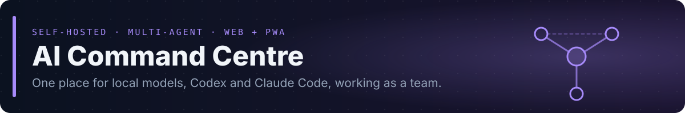

<!--
  AI Command Centre — LEIA-ME (resumo em português)
  Created by Redfox using Claude
-->

<div align="center">



<sub>🇬🇧 Full documentation in English: <a href="README.md">README.md</a></sub>

</div>

# 🛰️ AI Command Centre

**Centro de controlo de IA, privado e auto-alojado:** modelos locais (Ollama),
OpenAI Codex e Claude Code no mesmo servidor, a trabalhar em equipa, numa
aplicação web que também se instala no telemóvel (PWA).

## O que faz

- **Conversa** com o Ollama e o Codex num só sítio, com histórico pesquisável,
  anexos e projectos.
- **Equipa:** entrega-se um objectivo e um coordenador (por omissão o Codex)
  divide-o em subtarefas, distribui-as pelos agentes conforme o papel de cada
  um, revê o resultado e pede correcções até concluir. Os agentes trabalham em
  paralelo e vêem um quadro partilhado.
- **Projectos** com instruções, documentos, pesquisa e memória; o que um
  agente propõe para a memória fica pendente até ser aprovado.
- **Aprovações** obrigatórias para comandos, alterações de ficheiros,
  instalações e configuração, com registo de auditoria.
- **Claude:** o Claude Code (com a sessão que já tem no servidor) pode ser
  membro da equipa; as conversas do claude.ai podem ser importadas a partir da
  exportação oficial.

## Princípios

- Só autenticação **oficial** dos fornecedores: sem cookies do browser,
  tokens extraídos nem proxies. Não são precisas chaves de API.
- Todos os agentes começam **só de leitura**.
- Nada fica exposto à Internet: por omissão escuta só em `127.0.0.1`.

## Arranque rápido

```bash
git clone https://github.com/RafaDevpt/ai-command-centre.git
cd ai-command-centre
./scripts/primeira-vez.sh
docker compose up -d --build
docker compose exec app python -m app.cli criar-utilizador <nome>
```

Abrir em <http://127.0.0.1:3000> (ou por túnel SSH:
`ssh -L 3000:127.0.0.1:3000 <servidor>`).

A documentação completa (instalação, arquitectura, segurança, fornecedores,
cópias de segurança, resolução de problemas) está em [`docs/`](docs/), em inglês.

## Licença

[GPL-3.0](LICENSE) · Parte de [Personal AI Projects](https://github.com/RafaDevpt/Personal-AI-Projects), por Redfox.
