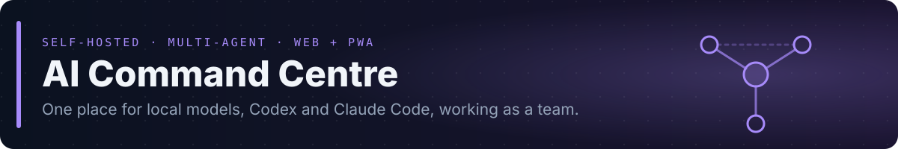
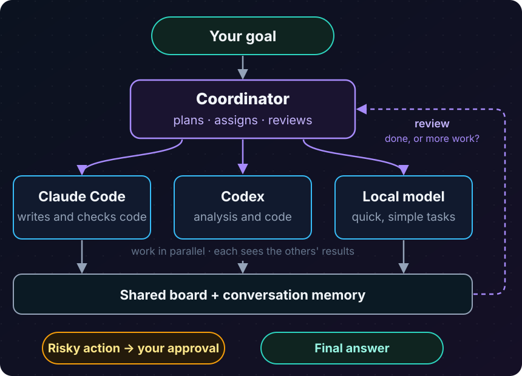
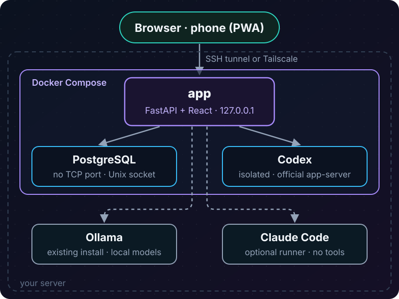

<!--
  AI Command Centre — README
  Laid out for a desktop screen first; every section still reads on a phone.
  Created by Redfox using Claude
-->

<div align="center">



<br />

[](https://github.com/RafaDevpt/ai-command-centre/actions/workflows/ci.yml)
[](https://github.com/RafaDevpt/ai-command-centre/releases/latest)


<br /><br />

<a href="https://github.com/RafaDevpt/Personal-AI-Projects"></a>
<a href="https://github.com/RafaDevpt/ai-command-centre/releases/latest"></a>

<sub>Part of <a href="https://github.com/RafaDevpt/Personal-AI-Projects"><b>Personal AI Projects</b></a> by Redfox</sub>

<br /><br />

<sub><b>WORKS WITH</b></sub><br />


</div>

# 🛰️ AI Command Centre

> **A self-hosted, private control room for AI: local models, OpenAI Codex and Claude Code, working together on one server.**

<table>
<tr>
<td width="33%" valign="top" align="center">

### 🤝
**Agents as a team**<br />
<sub>A coordinator splits the work; the agents do it in parallel and check each other.</sub>

</td>
<td width="33%" valign="top" align="center">

### 🔐
**Official sign-in only**<br />
<sub>No API keys, browser cookies or unofficial proxies.</sub>

</td>
<td width="33%" valign="top" align="center">

### 🛑
**You stay in control**<br />
<sub>Agents are read-only; anything risky waits for your approval.</sub>

</td>
</tr>
</table>

---

## What it does

Using several AI assistants usually means juggling tabs: one chat here, a local model in a terminal there, and copying answers from one to the other by hand.

AI Command Centre puts them behind a single web app that runs on your own server and also installs on a phone. You can chat with any of them, keep the history searchable, organise work into projects — and, most importantly, **hand a goal to a team of agents that plan, split, do and review the work between themselves**, while you watch the board and step in only when an action needs your approval.

---

## How it works

<table>
<tr>
<td width="50%" valign="top">

### 🔑 1 · Sign in
The first account is created on the server from the command line, never through the web. After that, you sign in from any browser on your network — or from your phone, where, over HTTPS, the app installs to the home screen. Sessions last seven days; *Settings* lists the devices signed in and can sign out all the others at once.

</td>
<td width="50%" valign="top">

### 🔌 2 · Connect the AI providers
**Ollama** is detected automatically, and only the models already installed are listed. **OpenAI Codex** uses the official *Sign in with ChatGPT* flow: the app shows a short code, which you type in on OpenAI's device sign-in page. **Claude Code** uses the CLI you have already signed in to on the server, with every tool switched off. The dashboard shows which providers are ready, with CPU, memory and disk use.

</td>
</tr>
<tr>
<td width="50%" valign="top">

### 💬 3 · Chat
Pick a provider and model, optionally a project, and type. Replies stream in as they are written, and you can stop one at any moment. Every conversation is saved, searchable and can be resumed later; text attachments are read into the conversation.

</td>
<td width="50%" valign="top">

### 📁 4 · Organise work into projects
A project holds standing instructions, documents and a memory of facts and decisions. When an agent wants to remember something, it only *proposes* it, and nothing reaches the shared context until you approve it. Each project sees only its own documents and memory.

</td>
</tr>
<tr>
<td width="50%" valign="top">

### 🤝 5 · Hand a goal to a team
Write a goal, choose a coordinator and the members, and set how many rounds they may take — for example Codex to plan, Claude Code to write and review code, and a local model for the simpler jobs. You follow the shared board live, leave notes, stop or retry; follow-up requests continue in the same conversation with its memory.

</td>
<td width="50%" valign="top">

### ✅ 6 · Approve anything risky
Agents start read-only. A command, a file change, an install or a configuration change appears on the *Approvals* page with the full details, and nothing happens until you approve it. Requests without an answer are refused after fifteen minutes, and every decision is recorded in the audit log.

</td>
</tr>
<tr>
<td width="50%" valign="top">

### 💾 7 · Keep it safe
`scripts/backup.sh` saves the database and the project files without stopping anything, and the containers restart cleanly: work interrupted by a restart is marked as such rather than left hanging.

</td>
<td width="50%" valign="top">

### 🚀 Ready to try it?
Four commands get it running — see [Quick start](#-quick-start).

<sub>The interface itself is in European Portuguese; this documentation is in British English.</sub>

</td>
</tr>
</table>

---

## 🤝 Team workflow

<p align="center"></p>

<table>
<tr>
<td width="50%" valign="top">

**🎯 Goal** — you describe what you want, in plain words.

</td>
<td width="50%" valign="top">

**🗺️ Plan** — the coordinator splits it into one to five sub-tasks and gives each to the member whose role fits best.

</td>
</tr>
<tr>
<td width="50%" valign="top">

**⚙️ Work** — members run in parallel; each sees the others' results on the shared board.

</td>
<td width="50%" valign="top">

**🔁 Review** — the coordinator writes the final answer or sends work back, sometimes asking one member to check another, up to the round limit you set.

</td>
</tr>
</table>

---

## 🧩 Modules

<table>
<tr>
<td width="33%" valign="top">

**🏠 Dashboard**<br />
<sub>Provider status, CPU · RAM · disk, recent sessions, pending approvals and running tasks.</sub>

</td>
<td width="33%" valign="top">

**💬 Chat**<br />
<sub>Ollama and Codex in one place, streamed live, with attachments, projects and a stop button.</sub>

</td>
<td width="33%" valign="top">

**🗂️ Sessions**<br />
<sub>Persistent, searchable history and archive; imported Claude conversations, read-only.</sub>

</td>
</tr>
<tr>
<td width="33%" valign="top">

**🧠 Models**<br />
<sub>What Ollama already has installed and what Codex offers — nothing is downloaded on its own.</sub>

</td>
<td width="33%" valign="top">

**📁 Projects**<br />
<sub>Instructions, documents with search, and memory that agents can only propose.</sub>

</td>
<td width="33%" valign="top">

**🤖 Agents**<br />
<sub>Codex, Ollama and Claude Code agents, each with its own model and role.</sub>

</td>
</tr>
<tr>
<td width="33%" valign="top">

**🤝 Team**<br />
<sub>Persistent team conversations with a live board, notes, stop and retry.</sub>

</td>
<td width="33%" valign="top">

**✅ Approvals**<br />
<sub>Commands, file changes, installs and configuration wait for you; full audit log.</sub>

</td>
<td width="33%" valign="top">

**⚙️ Settings**<br />
<sub>Password and devices, Codex sign-in, Claude import and backups.</sub>

</td>
</tr>
</table>

---

## 🏗️ Architecture

<p align="center"></p>

| Part | Design |
| :--- | :--- |
| **app** | One container serves the API and the built frontend, and listens on `127.0.0.1` by default. |
| **PostgreSQL** | No TCP port: the app reaches it through a Unix socket on an internal network. |
| **Codex** | Its own container, which cannot reach the database, the database password or attachments; it holds only its own Codex sign-in, and projects are mounted read-only. |
| **Claude Code** | Runs on the host behind a private socket, with tools, MCP servers, plugins and user settings disabled. |

Details and the reasoning behind each decision: [`docs/ARCHITECTURE.md`](docs/ARCHITECTURE.md).

---

## 🛡️ Security at a glance

| | |
| :--- | :--- |
| 🔑 **Login** | Local account, argon2id, `HttpOnly` + `SameSite=Strict` cookie, CSRF on every write and WebSocket message, rate limiting |
| 🧱 **Containers** | Non-root, read-only root filesystem, `cap_drop: ALL`, `no-new-privileges`, no Docker socket, no published ports |
| 🔐 **Providers** | Official sign-in only (Sign in with ChatGPT by device code; your own Claude Code session); credentials never reach the database, logs or API |
| 🛑 **Agents** | Read-only by default; commands and file changes wait for your approval and are refused after 15 minutes without one |
| 📁 **Isolation** | Each project sees only its own documents and memory; each team conversation only its own history |

Full list: [`docs/SECURITY.md`](docs/SECURITY.md).

---

## 📋 Before you start

<table>
<tr>
<td width="50%" valign="top">

**Requirements**

- Linux server with **Docker Engine + Compose v2** (BuildKit)
- **Ollama** *(optional)* with the models you want, on `127.0.0.1:11434`
- **ChatGPT account** with Codex access *(optional)*; plans with lower usage limits also work
- **Claude Code CLI** signed in with your claude.ai account *(optional)*

No API keys are needed.

</td>
<td width="50%" valign="top">

**Optional providers**

- **Codex** — *Settings → Sign in with ChatGPT*, then enter the code shown on OpenAI's device sign-in page
- **Claude Code** — install the runner as a user service ([how](docs/INSTALLATION.md#claude-code-as-a-team-member-optional)), then add an agent with provider `claude-code`
- **Claude app** — *Settings → Claude* imports the official data export as read-only sessions

Everything else works without them.

</td>
</tr>
</table>

---

## 🚀 Quick start

```bash
git clone https://github.com/RafaDevpt/ai-command-centre.git
cd ai-command-centre
./scripts/primeira-vez.sh
docker compose up -d --build
docker compose exec app python -m app.cli criar-utilizador <your-name>
```

| Step | What it does |
| :--- | :--- |
| `./scripts/primeira-vez.sh` | Creates `.env` and the database password; never overwrites existing files |
| `docker compose up -d --build` | Builds and starts the `db`, `app` and `codex` containers |
| `… criar-utilizador <your-name>` | Creates your account; the password is asked for and never shown |

Then open <http://127.0.0.1:3000> on the server, or from another computer through an SSH tunnel:

```bash
ssh -L 3000:127.0.0.1:3000 <server>
```

To use it from a phone, see [remote access](docs/INSTALLATION.md#access-from-other-devices) — **never expose it to the Internet**.

---

## ⚙️ Configuration

`.env` (created from [`.env.example`](.env.example), mode 600):

| Variable | Purpose and default |
| :--- | :--- |
| `AICC_HOST` | Address the app listens on — `127.0.0.1` |
| `AICC_PORT` | Port — `3000` |
| `AICC_LOG_LEVEL` | Log level — `info` |
| `AICC_OLLAMA_URL` | Ollama API — `http://127.0.0.1:11434` |

The database password lives in `config/db_password` and reaches the containers as a Compose secret.

---

## 📚 Documentation

| Document | Covers |
| :--- | :--- |
| 🧰 [Installation](docs/INSTALLATION.md) | Setup, updates, remote access, Claude Code runner |
| 🏗️ [Architecture](docs/ARCHITECTURE.md) | Components, decisions, data model |
| 🛡️ [Security](docs/SECURITY.md) | Containers, application, agents, secrets |
| 🔑 [Authentication](docs/AUTHENTICATION.md) | Local login, Codex and Claude sign-in |
| 🔌 [Providers](docs/PROVIDERS.md) | Ollama, Codex, Claude Code and the Claude app |
| 💾 [Backup and restore](docs/BACKUP-RESTORE.md) | `scripts/backup.sh` and how to restore |
| 🩺 [Troubleshooting](docs/TROUBLESHOOTING.md) | Common problems and fixes |
| 📝 [Changelog](docs/CHANGELOG.md) | What changed in each version |

---

## 🛠️ Development

**Backend** — the tests use fake Ollama, Codex and Claude and a temporary SQLite database, so no real provider is needed:

```bash
cd backend
uv venv --python 3.12 .venv
uv pip install --python .venv/bin/python -r requirements-dev.lock
.venv/bin/python -m pytest -q
uvx ruff check app tests
```

**Frontend** — React + TypeScript + Vite:

```bash
cd frontend
npm ci
npm run build
npm run lint
```

| Path | Contents |
| :--- | :--- |
| `backend/` | FastAPI app, Alembic migrations, tests |
| `frontend/` | React + TypeScript + Vite (PWA) |
| `docker/` | App image: frontend build, backend and the official Codex binaries |
| `docs/` | Documentation |
| `scripts/` | First run, start-up, backup and the Claude Code runner |
| `docker-compose.yml` | The `db`, `app` and `codex` services |

See [CONTRIBUTING.md](CONTRIBUTING.md) for branches and checks.

---

## ⚖️ Licence

[GPL-3.0](LICENSE). OpenAI Codex, Claude and Ollama belong to their respective owners; this project only uses their official clients and sign-in methods.

<div align="center">
<br />
<sub>Built by <b>Redfox</b> · part of <a href="https://github.com/RafaDevpt/Personal-AI-Projects">Personal AI Projects</a></sub>
</div>
