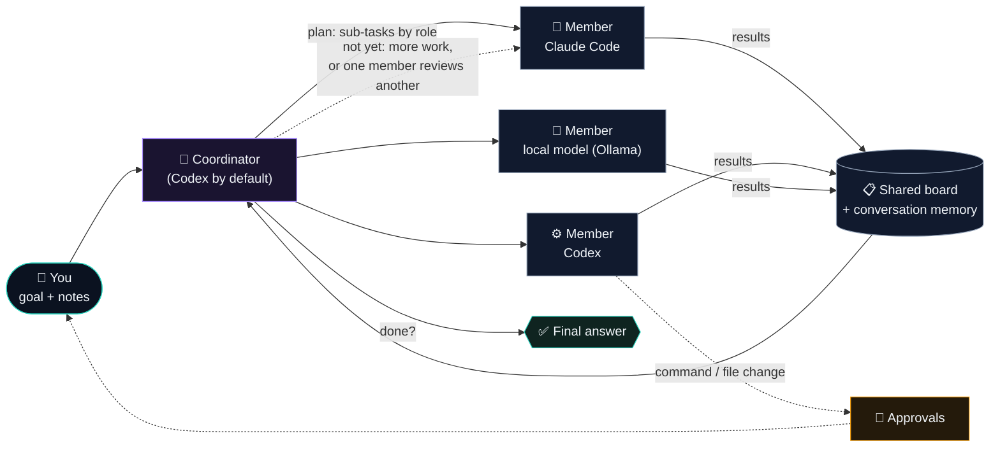
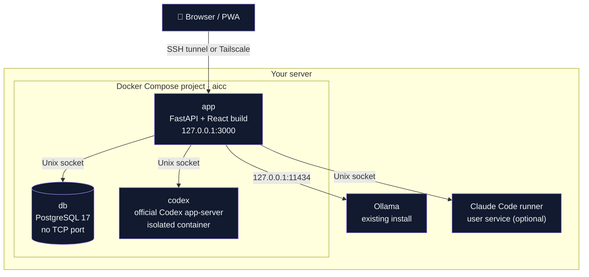

<!--
  AI Command Centre — README
  Created by Redfox using Claude
-->

<div align="center">


<br />

[](https://github.com/RafaDevpt/ai-command-centre/actions/workflows/ci.yml)
[](https://github.com/RafaDevpt/ai-command-centre/releases/latest)


<br /><br />

<a href="https://github.com/RafaDevpt/Personal-AI-Projects"></a>
<a href="https://github.com/RafaDevpt/ai-command-centre/releases/latest"></a>

<sub>Part of <a href="https://github.com/RafaDevpt/Personal-AI-Projects"><b>Personal AI Projects</b></a> by Redfox</sub>

</div>

# 🛰️ AI Command Centre

> **A self-hosted, private control room for AI: local models, OpenAI Codex and Claude Code, working together on one server.**

---

## What it does

Using several AI assistants usually means juggling tabs: one chat here, a local model in a terminal there, and copying answers from one to the other by hand.

AI Command Centre puts them behind a single web app (installable on a phone as a PWA) that runs on your own server. You can chat with any of them, keep the history searchable, organise work into projects — and, most importantly, **hand a goal to a team of agents that plan, split, do and review the work between themselves**, while you watch the board and step in only when an action needs your approval.

It signs in to providers **only through their official methods** — no browser cookies, no scraped tokens, no unofficial proxies — and every agent starts **read-only**.

---

## How it works

A typical day with AI Command Centre, from first sign-in to finished work:

### 1 · Sign in
The first account is created on the server from the command line, never through the web. After that, you sign in from any browser on your network — or from your phone, where, over HTTPS, the app installs to the home screen. Sessions last seven days; *Settings* lists the devices signed in and can sign out all the others at once.

### 2 · Connect the AI providers
- **Ollama** is detected automatically; the app lists the models already installed and never downloads new ones on its own.
- **OpenAI Codex** is connected with the official *Sign in with ChatGPT* flow: the app shows a short code, you open `auth.openai.com/codex/device` on any device and type it in. The sign-in stays on the server, inside the Codex container.
- **Claude Code** uses the Claude Code CLI you have already signed in to on the server. A small runner passes requests to it with every tool switched off.

The dashboard shows at a glance which providers are ready, together with CPU, memory and disk use.

### 3 · Chat
Pick a provider and model, optionally a project, and type. Replies stream in as they are written, and you can stop one at any moment. Every conversation is saved, searchable and can be resumed later; text attachments are read into the conversation.

### 4 · Organise work into projects
A project holds standing instructions (given to every model in that project), documents you upload, and a memory of facts and decisions. You add memory directly; when an agent wants to remember something, it only *proposes* it, and nothing reaches the shared context until you approve it. Each project sees only its own documents and memory.

### 5 · Hand a goal to a team
On the *Team* page you write a goal, choose a coordinator and the members, and set how many rounds they may take. The coordinator — Codex by default — splits the goal into sub-tasks and gives each to the member whose role fits best: for example, Codex to plan, Claude Code to write and review code, and a local model for the simpler jobs. Members work in parallel and can read each other's results on a shared board, which you can follow live. After each round the coordinator either writes the final answer or sends work back, sometimes asking one member to check another. You can leave notes for the next round, stop the team or retry a failed task, and follow-up requests continue in the same conversation with its memory.

### 6 · Approve anything risky
Agents start read-only. If one wants to run a command, change a file, install something or alter configuration, the request appears on the *Approvals* page with the full details. Nothing happens until you approve it; requests without an answer are refused after fifteen minutes. Every decision is recorded in the audit log.

### 7 · Keep it safe
`scripts/backup.sh` saves the database and the project files without stopping anything, and the containers restart cleanly: work interrupted by a restart is marked as such rather than left hanging.

> The interface itself is in European Portuguese; this documentation is in British English.

---

## Modules

| Module | What it covers |
| :--- | :--- |
| 🏠 **Dashboard** | Provider status, CPU / RAM / disk, recent sessions, pending approvals and running tasks |
| 💬 **Chat** | Ollama and Codex in one place, streamed over WebSocket, with attachments, projects and a stop button |
| 🗂️ **Sessions** | Persistent, searchable history; archive; imported Claude conversations (read-only) |
| 🧠 **Models** | Models already installed in Ollama and the models offered by Codex — nothing is downloaded automatically |
| 📁 **Projects** | Instructions, documents with search, and project memory; what agents propose stays pending until approved |
| 🤖 **Agents** | Codex, Ollama and Claude Code agents, each with a model and a role; create as many as you need |
| 🤝 **Team** | A coordinator splits a goal, assigns sub-tasks by role, members work in parallel and the coordinator reviews until done |
| ✅ **Approvals** | Mandatory for commands, file changes, installs and configuration; full audit log |
| ⚙️ **Settings** | Password and devices, Codex sign-in, Claude import, backups |

---

## Team workflow



1. **Plan** — the coordinator turns the goal into one to five concrete sub-tasks and assigns each to the member whose role fits best.
2. **Work** — different members run in parallel; each one sees the shared board with what the others produced.
3. **Review** — the coordinator either writes the final answer or asks for more work, including having one member check another.
4. **Repeat** — up to the round limit you choose; the last round must conclude. You can add notes, stop, or retry at any time.

Conversations are persistent: follow-up requests continue on the same board, with an editable memory shared by every agent.

---

## Architecture



- **One container** serves both the API and the built frontend; by default it listens on `127.0.0.1` only.
- **PostgreSQL has no TCP port** — the app reaches it through a Unix socket on an internal network.
- **Codex runs in its own container** that cannot reach the database, the database password or attachments; it holds only its own Codex sign-in, and projects are mounted read-only.
- **Claude Code runs on the host**, behind a private socket, with tools, MCP servers, plugins and user settings disabled.

Details and the reasoning behind each decision: [`docs/ARCHITECTURE.md`](docs/ARCHITECTURE.md).

---

## Security at a glance

| | |
| :--- | :--- |
| 🔑 **Login** | Local account, argon2id, `HttpOnly` + `SameSite=Strict` cookie, CSRF on every write and WebSocket message, rate limiting |
| 🧱 **Containers** | Non-root, read-only root filesystem, `cap_drop: ALL`, `no-new-privileges`, no Docker socket, no published ports |
| 🔐 **Providers** | Official sign-in only (Sign in with ChatGPT by device code; your own Claude Code session); credentials never reach the database, logs or API |
| 🛑 **Agents** | Read-only by default; commands and file changes wait for your approval and are refused after 15 minutes without one |
| 📁 **Isolation** | Each project sees only its own documents and memory; each team conversation only its own history |

Full list: [`docs/SECURITY.md`](docs/SECURITY.md).

---

## Requirements

- Linux server with **Docker Engine + Compose v2** (BuildKit)
- **Ollama** (optional) with the models you want to use, listening on `127.0.0.1:11434`
- **ChatGPT account** with Codex access (optional); plans with lower usage limits also work
- **Claude Code CLI** signed in with your claude.ai account (optional), for the Claude member

No API keys are needed.

---

## Quick start

```bash
git clone https://github.com/RafaDevpt/ai-command-centre.git
cd ai-command-centre
./scripts/primeira-vez.sh                 # creates .env and the database password (never overwrites)
docker compose up -d --build              # db, app, codex
docker compose exec app python -m app.cli criar-utilizador <your-username>
```

Then open <http://127.0.0.1:3000> on the server, or through an SSH tunnel:

```bash
ssh -L 3000:127.0.0.1:3000 <server>
```

To use it from a phone, see [remote access](docs/INSTALLATION.md#access-from-other-devices) — **never expose it to the Internet**.

### Optional providers

| Provider | How to enable |
| :--- | :--- |
| **Codex** | *Settings → Sign in with ChatGPT*, then enter the code shown at `auth.openai.com/codex/device` |
| **Claude Code** | Install the runner as a user service ([instructions](docs/INSTALLATION.md#claude-code-as-a-team-member-optional)), then add an agent with provider `claude-code` |
| **Claude (app)** | *Settings → Claude* imports the official data export as read-only sessions |

---

## Configuration

`.env` (created from [`.env.example`](.env.example), mode 600):

| Variable | Default | Purpose |
| :--- | :--- | :--- |
| `AICC_HOST` | `127.0.0.1` | Address the app listens on |
| `AICC_PORT` | `3000` | Port |
| `AICC_LOG_LEVEL` | `info` | Log level |
| `AICC_OLLAMA_URL` | `http://127.0.0.1:11434` | Ollama API |

The database password lives in `config/db_password` and reaches the containers as a Compose secret.

---

## Documentation

| Document | Covers |
| :--- | :--- |
| [Installation](docs/INSTALLATION.md) | Setup, updates, remote access, Claude Code runner |
| [Architecture](docs/ARCHITECTURE.md) | Components, decisions, data model |
| [Security](docs/SECURITY.md) | Containers, application, agents, secrets |
| [Authentication](docs/AUTHENTICATION.md) | Local login, Codex and Claude sign-in |
| [Providers](docs/PROVIDERS.md) | Ollama, Codex, Claude Code and the Claude app |
| [Backup and restore](docs/BACKUP-RESTORE.md) | `scripts/backup.sh` and how to restore |
| [Troubleshooting](docs/TROUBLESHOOTING.md) | Common problems and fixes |
| [Changelog](docs/CHANGELOG.md) | What changed in each version |

---

## Development

```bash
# Backend
cd backend
uv venv --python 3.12 .venv && uv pip install --python .venv/bin/python -r requirements-dev.lock
.venv/bin/python -m pytest -q          # fake Ollama, Codex and Claude; temporary SQLite
uvx ruff check app tests

# Frontend
cd frontend && npm ci && npm run build && npm run lint
```

```
ai-command-centre/
├── backend/            FastAPI app, Alembic migrations, tests
├── frontend/           React + TypeScript + Vite (PWA)
├── docker/             app image (frontend build + backend + official Codex binaries)
├── docs/               documentation
├── scripts/            first run, start-up, backup, Claude Code runner
└── docker-compose.yml  db · app · codex
```

See [CONTRIBUTING.md](CONTRIBUTING.md) for branches and checks.

---

## Licence

[GPL-3.0](LICENSE). OpenAI Codex, Claude and Ollama belong to their respective owners; this project only uses their official clients and sign-in methods.

<div align="center">
<br />
<sub>Built by <b>Redfox</b> · part of <a href="https://github.com/RafaDevpt/Personal-AI-Projects">Personal AI Projects</a></sub>
</div>
